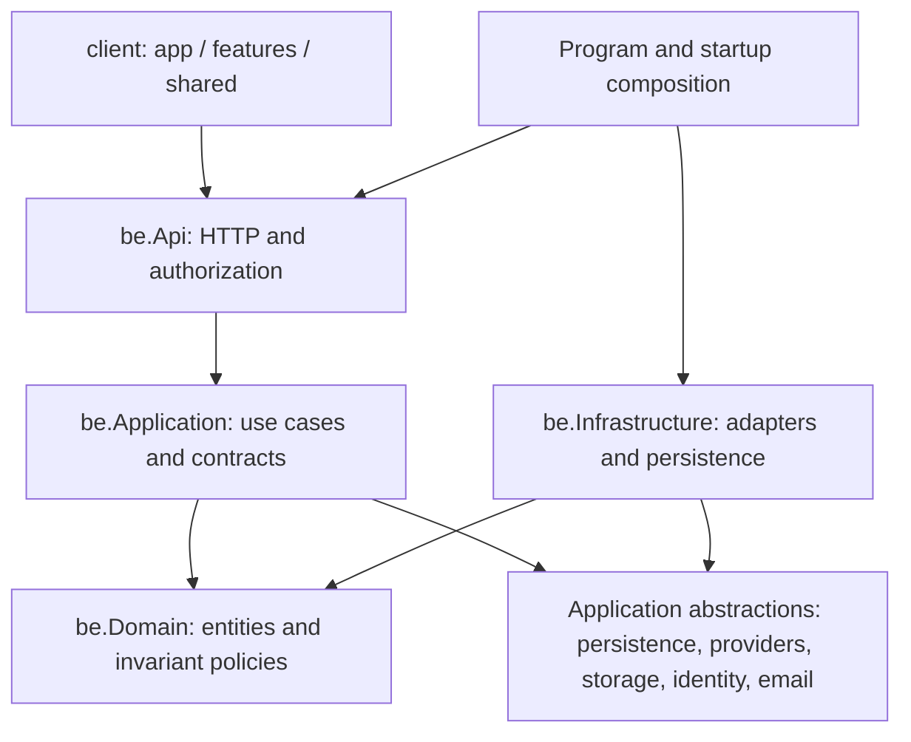

# Repository architecture

Amaara Creations is a modular monolith: one ASP.NET Core deployable, one SQL Server database and one React application. `be/` and `client/` remain the build/deployment roots. A physical project split would add migration, hosting and test churn without improving the current module interfaces; [ADR 0001](../adr/0001-modular-monolith.md) records that decision.

Application workflows depend on the EF unit-of-work seam rather than the concrete persistence implementation. They keep EF queries explicit; there is no repository, mediator, microservice or cross-process messaging layer. Infrastructure implements the external/provider and persistence seams. HTTP request binding, authorization, cookies, bounded body reads, status codes and response headers stay in API code.

| Area | Owner |
| --- | --- |
| Identity/accounts | User, sessions, roles/policies, authentication, addresses and profile. |
| Catalog | Products, variants, categories, collections and product media. |
| Custom designs | Builder configuration/pricing, designs, artwork, proof responses and snapshots. |
| Cart/wishlist | Customer-owned saved selections and standard/custom lines. |
| Checkout/orders | Quotes, order creation/idempotency, immutable snapshots and order history. |
| Payments | Provider identity, attempts, settlement, reconciliation and refunds. |
| Inventory/shipping/production | Reservations and movements, shipping configuration/snapshots, proofs and production progress. |
| Promotions/reviews | Redemption eligibility and verified-purchase/moderation rules. |
| CMS/reporting/audit | Public content/settings, currency-separated reporting and append-only evidence. |

Read [backend architecture](backend.md), [frontend architecture](frontend.md), [admin architecture](admin.md), the [domain glossary](../../CONTEXT.md), and [testing](testing.md). [The release engineering record](../release/engineering-record.md) distinguishes internal rehearsals from genuine provider acceptance. [The cutover runbook](../runbooks/release-cutover.md) covers environment configuration, deployment and recovery; [static preview](../runbooks/static-preview.md) describes the historical GitHub Pages path.

Changes should have one feature owner, preserve public contracts and financial history, and pass the relevant behavior tests. Shared modules earn their place by hiding a reusable lifecycle or integration concern. Architecture and compatibility tests enforce dependency direction, canonical routes, authorization/rate limits and historical migration payloads.
